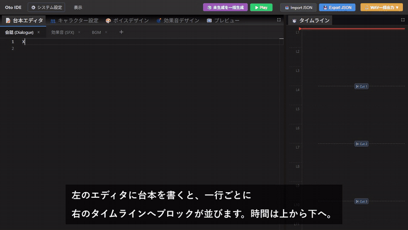
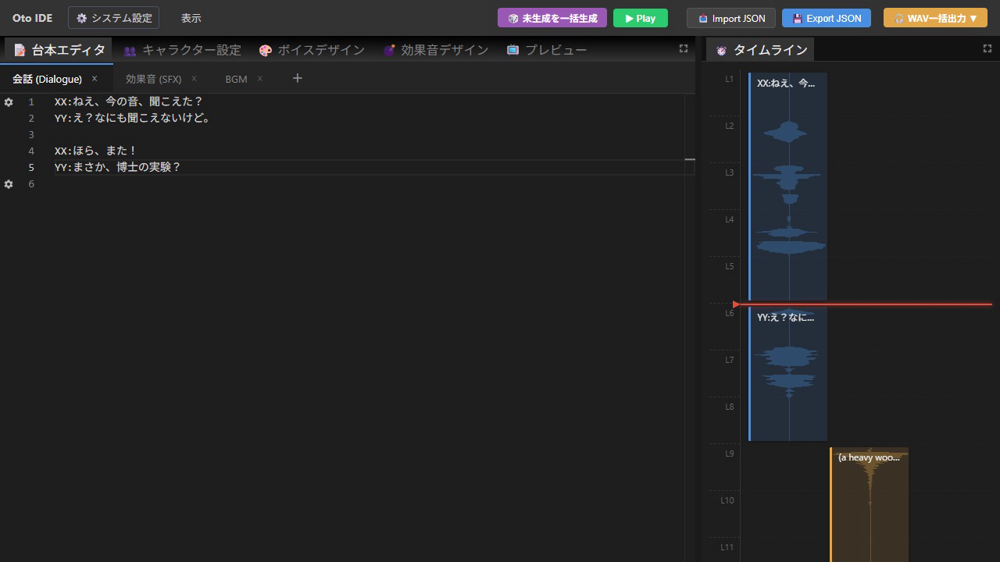

# oto

台本から音声ドラマをつくる、**縦型タイムラインのオーディオエディタ**です。
台本を書くと、セリフ（[Irodori-TTS](https://github.com/Aratako/Irodori-TTS)）と効果音（[AudioGen](https://github.com/facebookresearch/audiocraft)）をローカルで生成し、上から下へ流れるタイムラインに並べます。

[](docs/oto_intro.mp4)

▶ [ナレーション付きの紹介動画を見る（mp4・音声あり・約1分40秒）](docs/oto_intro.mp4)



## できること

- **台本エディタ** — `XX:セリフ` の形式で書くと、1行が1ブロックとしてタイムラインに並びます。会話・効果音・BGM はレイヤーごとに書き分けられます。
- **縦型タイムライン** — 時間は上から下へ流れます。ブロックをドラッグして並べ替えると、台本の行も同期して入れ替わります。
- **ボイスデザイン** — 「落ち着いた低めの声の、20代男性」のように声の特徴を文章で書いて、新しい声をつくります。手持ちの WAV もインポートできます。
- **キャラクター設定** — 台本上の ID（`XX` など）にボイスライブラリの声を割り当てます。
- **一括生成** — 「未生成を一括生成」を押すと、まだ音声がない行をすべて生成します。音声の長さに合わせて後続の行も自動でずらします。
- **演技ガチャ（テイク管理）** — 同じセリフを何度でも生成し直し、テイクを聴き比べて採用するものを選べます。テイクごとにカット位置・音量・パンも調整できます。
- **効果音デザイン** — 効果音を文章（日本語可、英語に自動翻訳）から生成します。
- **書き出し** — タイムライン全体のミックスダウン WAV のほか、個別カット済み WAV や無音埋めステム（ZIP）でも書き出せます。プロジェクトは JSON でインポート／エクスポートできます。

## 構成

```
frontend/                 React + Vite のエディタ本体
  vite-plugin-backend-manager.ts  画面の「システム設定」から Python サーバーを起動・停止する
backend/
  Irodori-TTS/            submodule（TTS 本体）
  audiocraft/             submodule（AudioGen 本体）
  api_irodori/            ボイスクローニング API (:7860) / ボイスデザイン API (:7861)
  api_audiocraft/         効果音生成 API (:7862)
outputs/                  生成された音声の一時置き場（git 管理外）
```

生成した音声は `frontend/public/uploads/` に保存され、台本・キャラクター・テイクの情報はブラウザの localStorage に保存されます。

## セットアップ

> **動作環境:** Windows（バックエンドの起動に `cmd.exe` と `taskkill` を使っています）、Node.js、NVIDIA GPU を推奨します。

### 1. リポジトリとサブモジュールを取得

```bash
git clone --recursive https://github.com/n416/oto.git
```

clone 済みの場合は次を実行します。

```bash
git submodule update --init --recursive
```

### 2. Irodori-TTS の環境をつくる

`backend/Irodori-TTS/.venv` に仮想環境をつくります（[uv](https://docs.astral.sh/uv/) を使用）。

```bash
cd backend/Irodori-TTS && uv sync
```

モデル（`Aratako/Irodori-TTS-500M-v3` など）は初回生成時に Hugging Face から自動でダウンロードされます。

### 3. AudioCraft の環境をつくる

`backend/audiocraft/.venv` に Python 3.10 の仮想環境をつくり、AudioCraft と API 用のパッケージを入れます。

```bash
cd backend/audiocraft && py -3.10 -m venv .venv && .venv/Scripts/pip install -e . fastapi uvicorn deep_translator
```

### 4. フロントエンドを起動

```bash
cd frontend && npm install && npm run dev
```

ブラウザで表示された URL を開き、**⚙️ システム設定** から使うバックエンドを起動します。

| サーバー | ポート | 用途 |
| --- | --- | --- |
| ボイスクローニング (Irodori-TTS) | 7860 | キャラクターの声でセリフを生成 |
| ボイスデザイン (Irodori-TTS) | 7861 | 文章から新しい声をつくる |
| 効果音生成 (AudioGen) | 7862 | 文章から効果音を生成 |

## 使い方

1. **ボイスデザイン** タブで声の特徴とサンプルのセリフを入力し、「新しい声を生成する」を押します。
2. **キャラクター設定** タブで、台本の ID（`XX`、`YY` など）に生成した声を割り当てます。
3. **台本エディタ** に `XX:こんにちは` のように台本を書きます。効果音は「効果音 (SFX)」レイヤーに `(a heavy wooden door slams)` のように書きます。
4. **未生成を一括生成** を押すと、全行の音声が生成されます。
5. 気になる行はタイムラインのブロック（またはエディタ左の ⚙）をクリックして、テイクを作り直したり選び直したりします。
6. **▶ Play** で確認し、**WAV一括出力** で書き出します。

## ライセンス

Irodori-TTS と AudioCraft（AudioGen）は、それぞれのリポジトリのライセンスに従います。AudioGen のモデル重みは CC-BY-NC 4.0 です。
